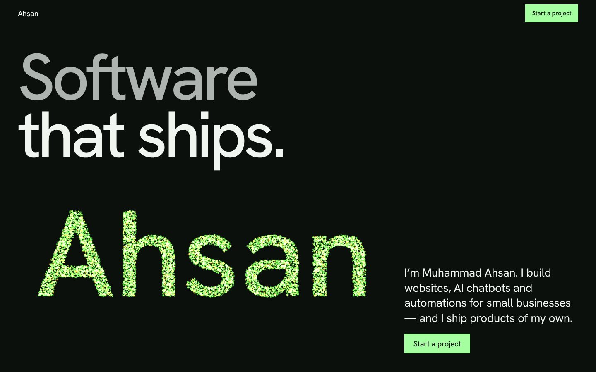
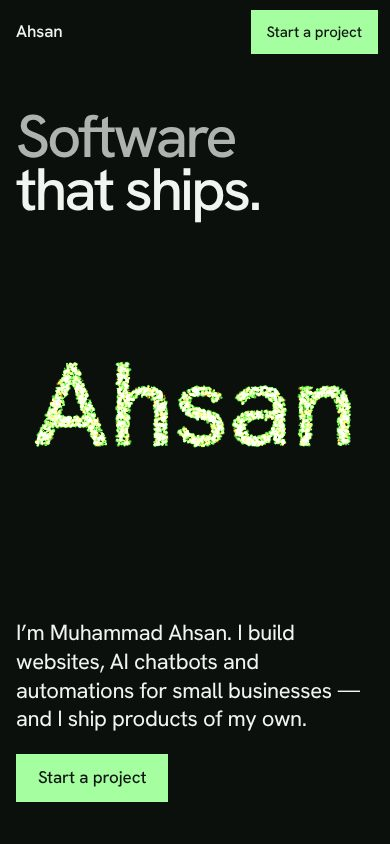
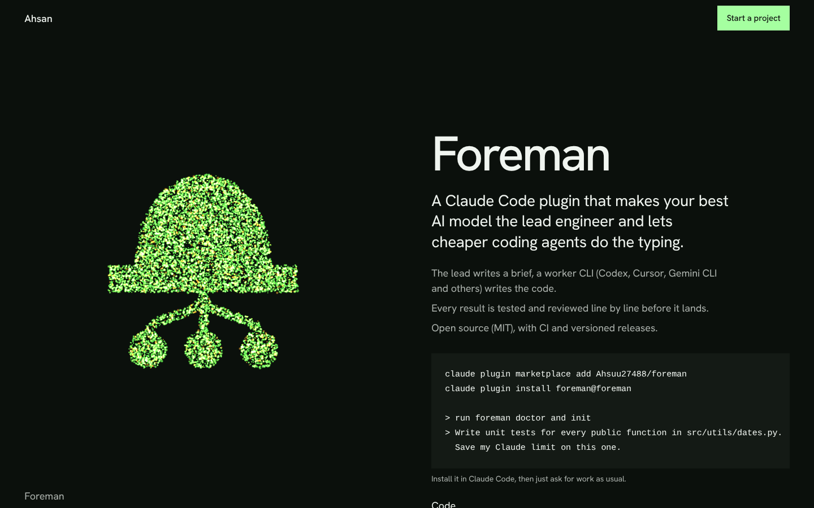
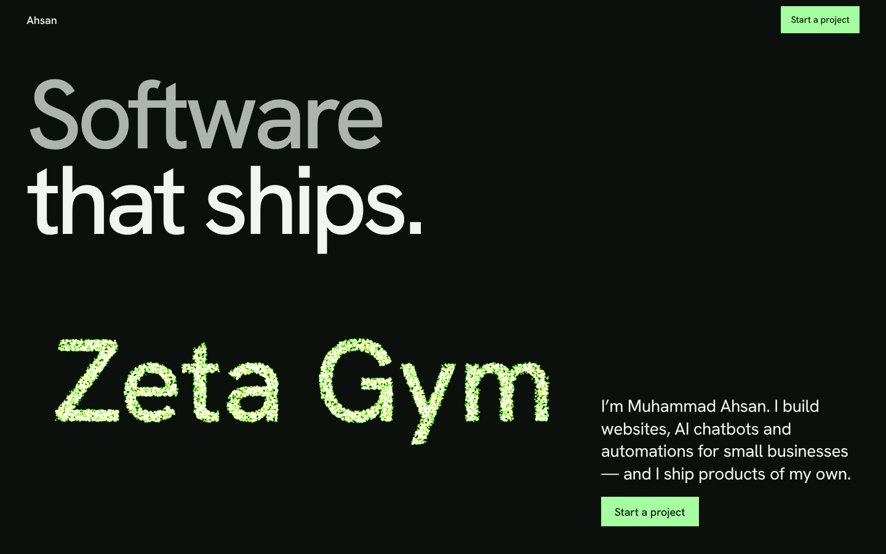

# ahsandev.site — Muhammad Ahsan's portfolio

Websites, AI chatbots and automation for small businesses, proven with shipped
products. The hero is a GPU particle swarm that writes "Ahsan" — or the
business name a visitor types — and rebuilds itself into the marks of
Taskvane, Chronos, Foreman and edit-recreator as you read about each one.

| Desktop | Phone |
|---|---|
|  |  |




## Stack

Next.js 16 (App Router, static) · React 19 · TypeScript · Tailwind CSS v4 ·
three.js (plain, one `Points` mesh, morph and pointer physics in the vertex
shader) · Vitest. Deploys as a static site on Vercel.

## Run

```bash
pnpm install
pnpm dev     # http://localhost:3000
pnpm test
pnpm build
```

## Performance and accessibility

- HTML text paints first; three.js loads after first paint (idle callback).
- ≤16k particles desktop / ≤6k phone, DPR ≤ 1.5, renders only while on screen.
- `prefers-reduced-motion`: still swarm, no entrances, video waits for controls.
- No WebGL: the same words render as text.

Design system: `DESIGN.md`. Product facts: `PRODUCT.md`.
